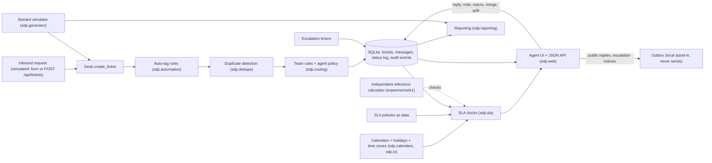

<p align="center"></p>

<p align="center">
  
  
  
</p>

# Customer Support Desk Platform

> Answer customers on time, spread the work fairly, and see where the queue is slipping.

A local, single-tenant helpdesk for small service businesses. Requests become tickets with an owner, a priority and an SLA clock that understands opening hours, holidays and time zones. Rules route and tag tickets, macros speed up replies, a web UI and a JSON API serve agents, and reports show whether the promises were kept. Python standard library only: no dependencies to install.

**Quick links:** [Architecture](#architecture) · [Tech stack](#tech-stack) · [Engineering decisions](#engineering-decisions) · [Roadmap](#roadmap) · [Case study](docs/case-study.md) · [Research report](docs/research-report.md)

> **Public showcase.** This repository holds the documentation, client case study, research report and measured results for this product. The runnable source code is distributed separately under a license: see [SOURCE-ACCESS.md](SOURCE-ACCESS.md).

## At a glance

|  |  |
|---|---|
| **Track** | Business |
| **Phase** | Beta: all five milestones are built and tested and all four experiments have recorded results. It runs locally on synthetic data only; it is not deployed, has no authentication, cannot send or receive real email, and has never been used with a real customer. |
| **Primary reader** | Clients and founders |
| **Read next** | [README](README.md) · [Client case study](docs/case-study.md) · [Research report](docs/research-report.md) |

## Why this exists

Small service businesses answer customers from a shared inbox and a few chat apps. Nobody can say which requests are unanswered, how late the team is against its own promises, or why one person is swamped while another is idle. Hosted helpdesks solve this but bring per-seat pricing, data you do not control and configuration you cannot inspect.

## What it does (all of this is built and tested)

- **Data model and rules engine (M1).** Customers, agents, teams, tickets, messages (public replies and internal notes), tags, priorities, status history and an audit trail in SQLite. **Business-hours calendars** with several windows per day, holidays and time zones (`zoneinfo` when the machine has the IANA database, otherwise a built-in rule-based stand-in, see limits). **SLA policies as data**: first-response and resolution targets per priority in business minutes, clocks that pause while the ticket is *waiting on customer* (and while resolved or closed), countdown states ok / at risk / breached / paused / met / missed.
- **Routing and automation (M2).** Rule-based team selection; agent selection by round-robin, least-loaded or skills-weighted policy; keyword auto-tagging (whole words and phrases); escalation timers (SLA percentage used, SLA breached, unassigned for N business minutes) with actions that bump priority, reassign to a team, add a tag or queue a notification; canned-response **macros** with a fixed variable set and fallbacks; **merge and split**; token-based **duplicate detection** (Jaccard, TF cosine or cosine with bigrams) with a configurable threshold.
- **Agent UI and JSON API (M3).** Server-rendered local web UI: queue with filters and SLA badges, ticket page, reply with macro, internal notes, merge/split, outbox viewer, configuration view, keyboard shortcuts (`j` `k` `/` `c` `r` `?`), semantic markup with labelled controls and table captions (no accessibility conformance is claimed: it has not been audited). A JSON API covers tickets, messages, status, priority, assignment, tags, merge, split, duplicates, macros, SLA preview, escalations, outbox, reports and surveys.
- **Reporting (M4).** First-response and resolution time (business and wall-clock minutes), SLA breach rate with Wilson intervals by priority and team, backlog age, agent workload with Gini coefficients, CSAT from survey rows, and a **seeded synthetic ticket generator / simulator** that drives the real desk code.
- **Experiments (M5).** E1 SLA calculator vs an independent reference; E2 routing policy comparison; E3 duplicate-detection precision/recall with the threshold swept; E4 API/UI throughput with machine load disclosed. Raw data and verdicts are in `results/`.
- A local **outbox** that stands in for email: every reply and escalation notice is recorded with status `queued`. Nothing is ever sent.

## Not built / out of scope

| Item | Why |
|---|---|
| Real email in/out, chat, phone or social channels | Needs provider accounts and credentials. Built as a **local stand-in**: the outbox table (`/outbox`, `/api/outbox`) records what would be sent; inbound requests are simulated by the "New ticket" form or `POST /api/tickets`. |
| Authentication, roles, permissions, audit of logins | Single-tenant local demo bound to `127.0.0.1` with no login. "Acting as" an agent is a cookie convenience, not a security control. Basic request hardening (form tokens, Host check, JSON content type, CSP) is in place but has not been security reviewed. |
| Multi-tenant isolation, hosted deployment, containers, queues, PostgreSQL | One SQLite file and one process (database work is serialised behind a lock). No container was built. |
| IANA time-zone database | Not available on the build machine (stock Windows Python without `tzdata`, and installing it would be a download). A rule-based fallback covers 18 named zones plus `UTC±hh:mm` with *current* US, EU and Australian-east DST rules only, no history. With `zoneinfo` data present the standard library is used instead; that path is not exercised on the build machine. |
| Survey delivery and collection page for CSAT | Scores can be posted to `POST /api/surveys` and are generated synthetically by the simulator; no survey email or form exists. |
| Semantic duplicate detection | Matching is lexical (shared words). Paraphrases with little word overlap are missed; E3 quantifies this on synthetic text only. |
| Editors for calendars, SLA policies, rules and macros in the UI | They are data and are created through the Python API or the seed script; the UI shows them read-only. |
| Attachments, rich text, per-ticket custom fields, knowledge base, customer portal | Not started. |
| Business-hours windows that cross midnight | Write a night shift as two windows (one ending at 24:00, one starting at 00:00). |
| Real-data validation | No real tickets exist; every experiment uses simulated data. Results describe the simulator, not any real support team. |

## Architecture



## Tech stack

| Layer | Technology actually used |
|---|---|
| Language, tooling | Python 3.12 (standard library only), `uv` to pick the interpreter, `unittest` |
| Persistence | SQLite via stdlib `sqlite3` (one connection behind a lock, foreign keys on) |
| Time | `datetime`, `zoneinfo` when available, otherwise `sdp.tz` rule-based stand-in |
| Web | `http.server` (`ThreadingHTTPServer`), server-rendered HTML with `html.escape`, one small CSS file and one small JS file served locally (no external assets) |
| Reporting and experiments | Plain Python statistics (bootstrap intervals, sign-flip permutation test, Holm correction, Wilson interval, Gini) |
| Notifications | Local outbox table (stand-in; nothing is sent) |
| CI | GitHub Actions workflow file `.github/workflows/ci.yml` (written to run the same commands as below; **never run**, because nothing was published) |

## Engineering decisions

### Business time is computed, not approximated

A calendar is a time zone, weekly windows in local wall-clock minutes and a set of holiday dates. To find "N business minutes after t" the code splits the time range into pieces with a constant UTC offset (so 23- and 25-hour days work), turns each local day's windows into UTC intervals, subtracts the paused intervals and walks forward. The same arithmetic produces the countdown, the breach decision and the reported business times. Experiment E1 checks it against a minute-by-minute reference that shares none of this logic.

### SLA policies are data, with explicit semantics

Targets are per priority in business minutes of the policy's calendar (no calendar means 24x7). The clock stops while the ticket is in a pause status (default *waiting on customer*) and while it is resolved or closed, and resumes on reopening. Targets are measured from ticket creation using the *current* priority, so raising a priority later re-targets retroactively (a documented design choice, not an industry rule). A merged ticket keeps its own clock; a split-off ticket starts a new one.

### Rules are inspectable

Routing rules, auto-tag keywords, escalation conditions and macros live in tables and are validated when saved (unknown priority, unknown macro variable, empty keyword list and similar are rejected). Escalations are idempotent: a rule fires at most once per ticket.

### Nothing leaves the machine

The server refuses to bind anything but a loopback address. Replies and escalations are rows in an outbox table. Seed data uses reserved `.example` domains. Experiments that start a server do so on `127.0.0.1` with a temporary database.

### Honest simulation

The simulator drives the real `Desk` code with simulated customers and agents (assumptions in `sdp/generator.py`: arrival rates, handling times, how often customers wait, a 1.8x slow-down when an agent lacks the ticket's skill). E2 compares routing policies *inside that model*; the skill-penalty assumption drives much of the result, and a scenario without it is included so the effect can be seen.

## Quality bar

- Calendar and SLA arithmetic is tested on ordinary days, weekends, holidays, multi-window days, pauses and the 23- and 25-hour days of US, EU and Australian DST changes.
- An independent minute-by-minute reference calculator is compared with the product on randomized calendars (E1), and deliberately broken variants of the product are shown to be caught.
- Status transitions, validation, search escaping, CSRF/Host/content-type checks, HTML escaping (including hostile ticket text and macro variables) and 4xx-not-5xx behaviour have tests.
- The simulator is seeded and deterministic; tests check timeline invariants (no message before its ticket, agents only act while their calendar is open, cached due times equal recomputed ones).
- Test status: see [Verification](#verification).

## Results at a glance

All data is **synthetic** and every workload is **simulated**; E4 ran on a shared machine that was already at 38% to 100% CPU load (disclosed per run in `results/e4_runs.csv`). Raw rows are in `results/`; tables, intervals and caveats are in the [research report](docs/research-report.md).

| Question | Verdict | Headline (mean or median [95% bootstrap CI]) |
|---|---|---|
| E1: does the SLA calculator agree with an independent reference? | Supported on generated cases | 1,500 random calendars, 7,369 comparisons, 0 disagreements (3,563 near a DST change); four deliberately broken variants were each caught. Time-zone rules not independently checked; no IANA data on the machine. |
| E2: does skills-weighted routing lower the breach rate? | Only under the simulator's skill-mismatch assumption | First-response breach rate at moderate load: round-robin 0.163 [0.142, 0.186], least-loaded 0.119 [0.102, 0.139], skills-weighted 0.049 [0.041, 0.058]; with the 1.8x mismatch slow-down removed: 0.050, 0.038, 0.048 (skills-weighted no better than round-robin, slightly worse than least-loaded). Skills-weighted is less balanced (Gini of assigned tickets 0.141 vs 0.019 round-robin). |
| E3: can token similarity find duplicates? | Weak on this synthetic data | Best F1 0.65 to 0.69 for every method; same-topic tickets with different details are the main false positives. At the default threshold (cosine 0.6, medium paraphrase): precision 0.70 [0.67, 0.72], recall 0.33 [0.31, 0.35]. |
| E4: what throughput does the server sustain? | About 47 to 75 requests/s on this loaded machine, no errors | Median 46.5 [37.9, 47.5] req/s at 1 client thread, 74.9 [52.9, 82.6] at 4, 62.9 [59.4, 67.6] at 8; p95 latency 64, 150, 311 ms. Cause of the plateau not profiled. |

## Roadmap

- [x] M1: data model and rules engine (customers, agents, teams, tickets, messages, tags, priorities, calendars with holidays and time zones, SLA policies as data with pause and business-hours awareness, SQLite persistence; `tests/test_m1_*.py`)
- [x] M2: routing and automation (rule-based assignment with skills, load and round-robin; auto-tagging; escalation timers; macros with variables; merge and split; duplicate detection; `tests/test_m2_*.py`)
- [x] M3: agent UI and JSON API (`tests/test_m3_web.py`)
- [x] M4: reporting, CSAT, seeded synthetic ticket generator (`tests/test_m4_reporting_generator.py`)
- [x] M5: experiments E1 to E4 with recorded results (`tests/test_m5_experiments.py`, `results/`)
- [ ] Not on the roadmap yet: real email and chat channels, authentication, survey collection, configuration editors, IANA time-zone verification on a machine with `tzdata`, real-data validation

## Getting started

> _These instructions refer to the source package, which is distributed separately and is not part of this showcase repository._

Requires Python 3.12 or newer. [uv](https://docs.astral.sh/uv/) is convenient (`uv run` picks the interpreter, and there is nothing to install: the project has no dependencies); plain `python` works the same. Windows 11 with bash and PowerShell was used. These are the commands that were run:

```bash
uv run python -m sdp seed          # create data/desk.db with SYNTHETIC configuration and a history of tickets
uv run python -m sdp serve         # UI and API on http://127.0.0.1:8080 (creates the database if it is missing)
uv run python -m sdp report        # reporting summary as JSON
uv run python -m sdp escalate      # run escalation rules once (or: serve --escalate-every 60)
```

Open http://127.0.0.1:8080, filter the queue, open a ticket, load a macro, reply, add an internal note, try merge and split, and look at `/reports` and `/outbox`. Settings are optional environment variables, see `.env.example`. Offline runs: add `--offline` to `uv run`.

```bash
uv run python -m unittest discover -s tests -t .     # all tests
uv run python -m experiments.run_all                  # E1 to E4 into results/ (tens of minutes)
uv run python -m experiments.run_all --quick          # harness smoke test into .tmp/results-quick
uv run python -m experiments.e1                       # or one experiment: e1, e2, e3, e4
uv run python -m experiments.summarize                # rebuild results/summary.md from the raw CSVs
uv run python -m tools.coverage_lite                  # line coverage with the stdlib trace module
```

The CI workflow in `.github/workflows/ci.yml` runs the tests and the quick experiment run. **It has not been executed anywhere**; the local commands above are what was actually run.

## Verification

> _These instructions refer to the source package, which is distributed separately and is not part of this showcase repository._

Last verified from a clean short-path copy (`C:\w\sdp`, made without `.venv`, `.tmp`, caches, `data` and database files, then deleted), with `uv run --offline python -m unittest discover -s tests -t .`:

- **304 tests**: 44 time-zone and calendar, 59 SLA and data model, 54 routing / duplicate detection / macros / tag rules, 25 escalation / merge / split, 64 web UI and API (including HTML-escaping, CSRF, Host, content-type and structural markup checks and a few real-socket tests), 35 reporting / generator / simulator / seed command, 23 experiment harness.
- The suite passed in two consecutive runs from the final clean copy (138 s and 150 s on a machine that was already busy). An earlier clean-copy run passed once and failed once: the failure was a timing assertion in the tiny E4 harness test (a 1.5 s window had too few requests under heavy machine load); the assertion was loosened and the two runs above were made afterwards. Two tiny E4 runs also showed an unexplained one-connection stall (see the research report, threats to validity); it was not reproduced.
- `python -m experiments.run_all --quick` was run from the clean copy and completed.
- **Line coverage of `sdp/`: 96.1%** (3,232 of 3,364 executable lines) from `python -m tools.coverage_lite`, which uses the standard-library `trace` module, skips the experiment-harness tests, follows only the main thread (so code that runs in HTTP server threads, `sdp/web/server.py` at 61%, is undercounted) and measures lines executed, not behaviour checked. No branch coverage.
- Only Python 3.12.13 on Windows 11 was tested. No linter or type checker was available offline; a small standard-library script was used to look for unused imports.
- The web UI was exercised by hand in one browser (queue and ticket pages); the JavaScript (keyboard shortcuts, auto-refresh toggle) has no automated tests, and nothing was tested on other browsers or screen readers.
- The full experiment run (`E1` to `E4`) was executed once and its raw output is in `results/`; E3 was run twice (see the research report's change log).
- The GitHub Actions workflow has **not** been run.

## Repository layout

> _These instructions refer to the source package, which is distributed separately and is not part of this showcase repository._

```
sdp/            tz, calendars, sla, db, desk, routing, automation, dedupe, macros, outbox, reporting, textgen, generator, seed, web/
experiments/    E1-E4 scripts, summarize.py, run_all.py, common.py
tools/          coverage_lite.py
results/        raw per-run CSVs, *_meta.json (machine, versions, CPU load), summary.md/json (generated)
tests/          unittest suites per milestone
docs/           case study, research report, assets
```

## Skills demonstrated

`Business-time and time-zone arithmetic` · `Rules-engine design` · `SQLite data modelling` · `Server-rendered web UI and JSON API with the standard library` · `Discrete-event simulation` · `Experiment design with confidence intervals` · `Honest reporting of limits`

## One project, three lenses

The same project is documented for three audiences, so one body of work serves every goal.

| If you are… | Read | You will find |
|---|---|---|
| Hiring or reviewing engineers | [This README](README.md) | Architecture, trade-offs, quality bar and what the author would defend in a design review |
| A client or founder | [Client case study](docs/case-study.md) | The business problem, the value levers, how it is measured and how an engagement runs |
| A researcher or technical reviewer | [Research report](docs/research-report.md) | Hypotheses, methods, results with confidence intervals, limits and the reproducibility checklist |

## Author

Built by **[The Diamond Empire](https://thedempire.shop/)**. See [SOURCE-ACCESS.md](SOURCE-ACCESS.md).
