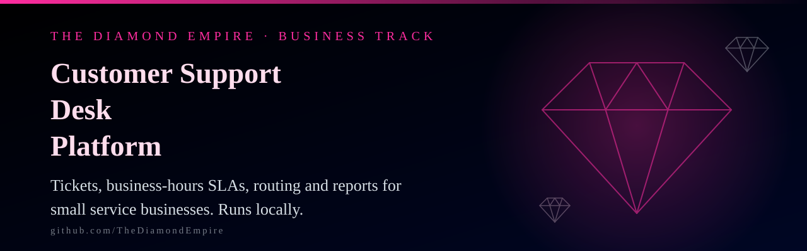

# Customer Support Desk Platform: Client Case Study

> Answer customers on time, spread the work fairly, and see where the queue is slipping.

> **Status of this document.** This is a reference case study: it sets out the business problem, the solution and the value model. The results table is intentionally blank and is filled in only from measured data (a pilot or a real engagement). No outcome figures are claimed here. The platform behind it exists as a working local prototype on synthetic data: it has never handled a real customer, has no authentication, and cannot send or receive email. Benchmark results on simulated workloads are in the [research report](research-report.md) and are not client outcomes.

## Snapshot

|  |  |
|---|---|
| **Who it is for** | Owners and office managers of small service businesses (clinics, repair and installation firms, agencies, home-service companies) with roughly three to thirty people answering customers. |
| **Solution** | A ticket desk that knows your opening hours, promises response and resolution times that count only business hours, routes each request to the right person, and reports whether the promises were kept. |
| **Track** | Business |
| **Delivered by** | The Diamond Empire (https://thedempire.shop/) |

## The challenge

Requests arrive in a shared inbox, a phone log and a few chat apps. Nobody is sure which ones have been answered, the same problem is reported three times, one person ends up with the awkward cases while another is idle, and "we reply within a day" is a hope rather than a number. When a customer chases, the answer to "how late are we?" takes an hour of digging.

## The solution

A single-tenant helpdesk. Every request becomes a ticket with an owner, a priority and a clock. Opening hours, time zones and holidays are data, so a promise of "first reply within four business hours" is measured the way your customer understands it, and the clock stops while you wait for the customer.

What the client gets in practice:

- Tickets with customers, messages, internal notes, tags, priorities, teams and agents, stored in SQLite
- Business-hours calendars with holidays and time zones, and SLA policies kept as data (first-response and resolution targets per priority, clocks that pause while waiting on the customer)
- Assignment by rules (which team) and by policy (round-robin, least-loaded or skills-weighted agent), keyword auto-tagging, escalation timers, canned-response macros with variables, merge and split, and warnings about likely duplicates
- A local web UI for agents (queue with filters and SLA countdown badges, ticket page, reply with macro, internal notes, keyboard shortcuts) and a JSON API
- Reports: first-response and resolution times, SLA breach rate, backlog age, agent workload and CSAT
- An outbox that records every message the desk would send, so behaviour can be checked safely before any email connection exists

## How it creates value

| Value lever | How the solution delivers it | How we measure it |
|---|---|---|
| Response time | Priorities, routing and countdown badges put the most urgent ticket in front of the right person | First-response time (business minutes); share of tickets answered within target |
| Promises kept | Business-hours SLAs with paused clocks; escalation rules fire before a breach | SLA breach rate by priority and team |
| Fair workload | Routing considers load and skills; workload report shows the spread | Open tickets and assigned tickets per agent; Gini coefficient of the spread |
| Less repeated work | Duplicate warnings, merge and split keep one conversation per problem | Merged tickets per month; duplicate flags confirmed by agents |
| Customer satisfaction | Faster, owned replies; a satisfaction score per ticket | CSAT (survey collection is an engagement item, see below) |
| Visibility | One queue, one backlog view, one audit trail per ticket | Backlog age buckets; oldest open tickets |

## How an engagement runs

| Phase | What happens |
|---|---|
| Model | Capture opening hours, holidays, time zones, SLA targets, teams, skills, tags and routing rules; load them as data |
| Connect | Connect the real channels the prototype only stands in for (email in and out), and add sign-in. Engagement work, not built |
| Pilot | One team for two to four weeks with a before/after comparison of the measures above |
| Expand | Remaining teams, calendars and local rule variants |

## What the client receives

- A configured instance with the client's calendars, SLA policies, teams, rules and macros
- Training for agents and the person who owns the configuration
- A baseline report taken before go-live and the same report afterwards
- Integration of the client's email provider and authentication (engagement work: the prototype has neither)
- Survey delivery and collection for CSAT (engagement work: the prototype only stores scores that are posted to its API or generated as synthetic data)

## Results

Baseline measurements are taken **before** the solution goes live, and the same measures are taken after, so every change in the table is attributable and honest.

| Measure | How measured | Baseline | After | Change |
|---|---|---|---|---|
| First-response time | Median and 90th percentile, business minutes | — | — | — |
| SLA breach rate | Breached clocks / clocks with a known outcome | — | — | — |
| Backlog age | Median age of open tickets | — | — | — |
| Workload spread | Gini coefficient of open tickets per agent | — | — | — |
| CSAT | Mean score and share of 4 and 5 | — | — | — |

> **To fill in:** replace each — with measured values and add the measurement window and sample size beneath the table.

## How quality and risk are managed

- Automated tests for the calendar and SLA arithmetic (including days that are 23 or 25 hours long), the status rules, routing, rules, merge and split, the UI and the API; counts are in the README
- The SLA calculator is checked against an independent, deliberately naive reference over randomized calendars (experiment E1 in the research report), and the check itself is proven able to catch four kinds of deliberate bug
- Every ticket has an audit trail of status, priority, assignment, tag, merge and escalation events
- Everything runs locally on `127.0.0.1`; the demo contains only invented people and companies, and the outbox never sends anything
- Known limits are stated plainly in the README and in the research report: no authentication, no real email, a rule-based fallback for time zones on machines without the IANA database, lexical (not semantic) duplicate detection, and simulated rather than real workloads

## Is this a fit?

Best suited to a small team that wants a clear, inspectable ticket desk it can own and adapt, and that is willing to have the email connection and sign-in added in an engagement. It is **not** a fit as a drop-in replacement for a large hosted helpdesk: there are no real channels, no multi-tenant isolation, no role-based access and no mobile app.

## Talk to us

Want this adapted to your business? Get in touch via **[thedempire.shop](https://thedempire.shop/)**.

---

[README](../README.md) · [Client case study](case-study.md) · [Research report](research-report.md)
